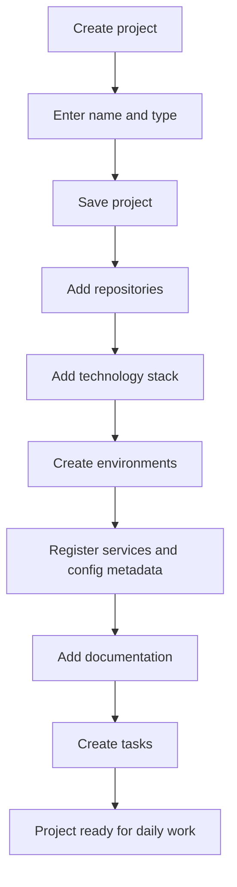
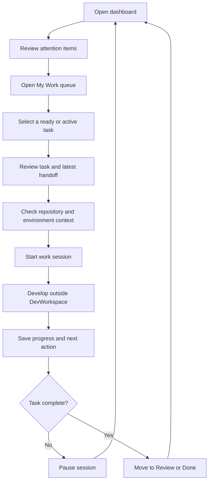
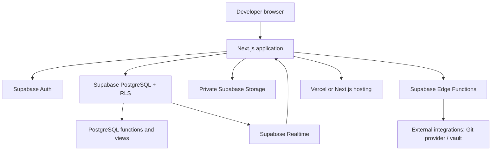
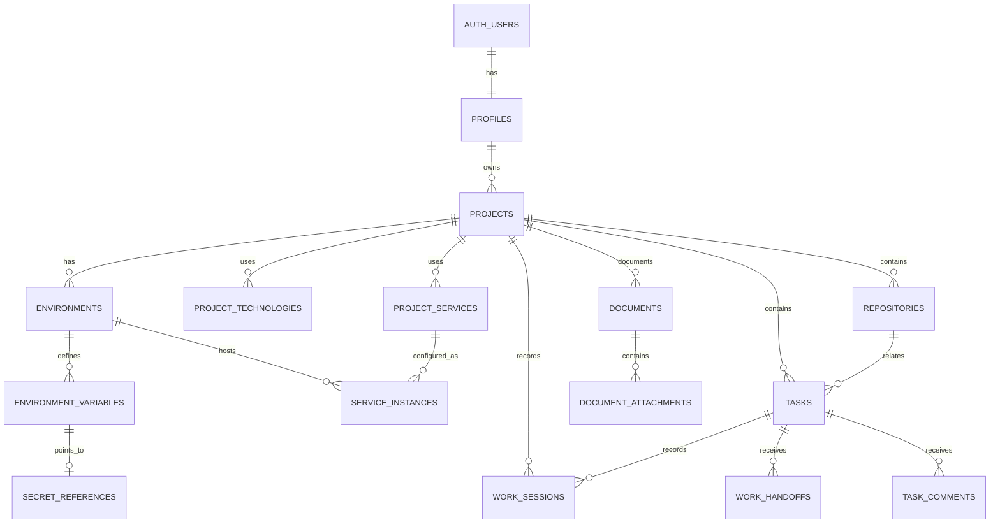
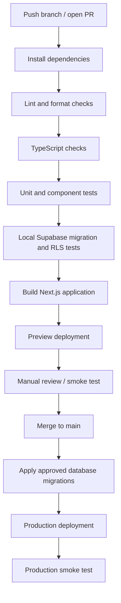

# DevWorkspace — Product Requirements & End-to-End Implementation Specification

**Document type:** Product Requirements Document (PRD), Functional Specification, Technical Architecture, Data Model, Security Plan, and Implementation Roadmap  
**Version:** 1.0  
**Prepared:** 19 November 2026  
**Product status:** Proposed — ready for design and implementation planning  
**Initial deployment:** Cloud-hosted  
**Initial workspace model:** Personal / single-user  
**Task management:** Native DevWorkspace task manager  
**Backend platform:** Supabase  

---

## Document purpose

This document is the working source of truth for designing and building DevWorkspace. It explains **what to build, why it exists, how each feature should behave, how the features connect, how the system should be implemented, and how to verify that it works**.

It is intended to be used by the product owner, designer, developer, and coding assistant throughout implementation. Requirements are deliberately divided into:

- **MVP:** Required for the first useful production release.
- **Post-MVP:** Valuable extensions that should not delay the core product.
- **Out of scope:** Capabilities DevWorkspace should not attempt to own in its initial architecture.

Where a detail has not yet been validated with actual use, it is identified as a recommendation or an open decision rather than presented as a proven requirement.

---

# 1. Product definition

## 1.1 Product summary

**DevWorkspace** is a cloud-hosted personal engineering workspace for software developers who work across several applications, repositories, tasks, and deployment environments.

It provides one connected place to:

1. Register and understand software projects.
2. Track development work across all projects using a native task manager.
3. Record the exact progress made on a task and the next action required.
4. Document local, development, staging, production, and custom environments.
5. Record databases, hosting, storage, APIs, services, and configuration requirements.
6. Keep technical documentation, setup instructions, and frequently used commands searchable.
7. Find information without reopening several tools, conversations, or old notes.

DevWorkspace is not simply a to-do list or a collection of project notes. Its value comes from connecting **project context, work management, and technical environment context**.

## 1.2 Product vision

> Every project, task, repository, environment, and technical note should be understandable from one connected engineering workspace. A developer should be able to stop working, switch projects, and return later without reconstructing what happened or searching for the information needed to continue.

## 1.3 Problem statement

A developer working across multiple projects often stores information in separate places:

- Project descriptions and plans in a notes application.
- Tasks in messages, issue trackers, spreadsheets, or memory.
- Repositories in GitHub or Bitbucket.
- Local setup commands in README files or terminal history.
- Production and staging information in scattered notes.
- Environment-variable names in `.env.example` files.
- Actual credentials in an external password manager or secrets platform.
- Progress and next steps in personal notes or chat conversations.

This fragmentation causes recurring problems:

- It is difficult to see all pending tasks in one prioritized queue.
- Switching projects creates context-recovery overhead.
- A task can remain marked “In Progress” even when nobody remembers its next action.
- Local and production configuration details can be confused.
- The same technical information is repeatedly searched for or rewritten.
- Project documentation does not reliably connect to tasks, repositories, and environments.
- A developer can accidentally use the wrong database, API endpoint, or deployment instructions.

## 1.4 Product goals

| ID | Goal | Intended outcome |
|---|---|---|
| G-01 | Centralize project context | Every project has a structured technical home. |
| G-02 | Unify task tracking | All personal development tasks appear in one work queue. |
| G-03 | Preserve work continuity | Every active task has a clear next action and useful handoff. |
| G-04 | Document environments | Local, development, staging, production, and custom environments are distinguishable. |
| G-05 | Organize engineering knowledge | Setup guides, commands, architecture notes, and troubleshooting are searchable. |
| G-06 | Reduce context switching | Common project information is accessible from connected screens. |
| G-07 | Protect sensitive information | DevWorkspace stores secret references and metadata, not raw credentials. |
| G-08 | Keep the system maintainable | A modular Next.js application uses Supabase rather than an unnecessary custom backend for MVP. |

## 1.5 Success measures

The first release should be evaluated through practical usage, not vanity metrics.

| Measure | MVP success signal |
|---|---|
| Project coverage | The developer can register all active projects and their repositories. |
| Task visibility | All current work can be found through the global work queue. |
| Task continuity | An in-progress task has a meaningful next action or an explicit reason why it does not. |
| Environment coverage | Each active project can document its relevant environments and services. |
| Retrieval | Common commands and technical information can be found through project navigation or search. |
| Cross-device use | The same account can access the same workspace from another browser/device. |
| Security | Automated tests demonstrate that unauthenticated users and other user IDs cannot read or alter private records. |
| Operational reliability | Database changes are migrated from source control and production backups/recovery are documented. |

Do not invent numeric targets before baseline usage exists. Add usage analytics only after the core workflows are stable and only collect what is necessary.

## 1.6 Initial user and operating model

**Primary user:** An individual software developer managing multiple personal, client, internal, or learning projects.

Initial assumptions:

- One authenticated user owns one personal workspace.
- The user can create many projects.
- A project can contain multiple repositories.
- A project can contain multiple environments.
- A project can contain many tasks, documents, services, and work sessions.
- Tasks are personally owned by the authenticated user in MVP; team assignment is not implemented yet.
- The user may record external references such as an existing ticket URL, pull request URL, or client request source without integrating the external system.

**Future compatibility:** Include `owner_id` on user-owned records and enforce ownership consistently. This makes later team support easier, but does not mean that multi-user collaboration, roles, invitations, or shared workspaces are part of MVP.

---

# 2. Scope and prioritization

## 2.1 MVP scope

The first production release includes:

1. Authentication and private personal workspace.
2. Main application shell and global dashboard.
3. Project registry and project detail pages.
4. Repository registry within projects.
5. Project technology stack registry.
6. Native task manager, including list and board views.
7. Global task queue and task filters.
8. Task comments, labels, subtasks, and dependencies (with sensible limits).
9. Work sessions and progress handoffs.
10. Environment registry and environment comparison.
11. Environment configuration-variable metadata (not secret values).
12. Project service and infrastructure registry.
13. Technical documentation and command library.
14. Basic global search.
15. Activity history for important changes.
16. Private document attachments.
17. Secure Supabase RLS policies, validation, tests, and production deployment.

## 2.2 Post-MVP scope

These features should be designed for, but not required to ship, the first release:

- GitHub and Bitbucket repository synchronization.
- Pull request and commit references populated automatically.
- A local CLI (`devworkspace init`) for repository discovery.
- Safe `.env.example` metadata import.
- Infisical, Doppler, or 1Password integration for secret references and configuration checks.
- Deployment history integration.
- Error-monitoring integrations.
- AI-assisted task summaries, documentation summaries, and handoff suggestions.
- Advanced search across all content.
- Optional team workspaces, invitations, roles, and task assignment.
- Browser notifications or email reminders.
- PWA/offline capabilities.

## 2.3 Explicitly out of scope

Do not build these as part of MVP:

- A Git client or code editor.
- CI/CD pipeline execution or deployment orchestration.
- Server provisioning or remote shell management.
- A general-purpose cloud monitoring platform.
- A custom password manager or secrets vault.
- A replacement for GitHub, Bitbucket, Jira, Linear, or a full issue tracker used by a large organization.
- Employee timesheets, payroll, or billing.
- Kubernetes cluster management.
- AI agents that modify repositories or execute arbitrary commands.

## 2.4 Priority definitions

- **P0 — Release blocker:** Required for secure or functional MVP.
- **P1 — Core value:** Required for the MVP to deliver the intended workflow.
- **P2 — Useful enhancement:** Add if the core release is stable and time allows.
- **P3 — Future:** Explicitly defer until validated.

---

# 3. Information architecture and navigation

## 3.1 Main navigation

Keep the left navigation small and organized around work rather than around database entities.

### Workspace

- **Overview** — global dashboard.
- **My Work** — global task queue and task views.
- **Work Sessions** — current and previous sessions/handoffs.

### Projects

- **All Projects** — project registry.
- Project detail pages — overview, tasks, repositories, environments, services, documents, activity.

### Engineering Knowledge

- **Environments** — global environment list and comparison entry point.
- **Knowledge Base** — documents and command library.
- **Services** — global service registry / cross-project service search.

### Personal

- **Settings** — profile, timezone, preferences, security, export.

Global search and a quick-create action should be available from the application header.

## 3.2 Main application layout

The desktop layout should include:

- Collapsible left sidebar.
- Top header with breadcrumbs, global search, quick-create, and profile menu.
- Main content area with page title, description, filters, and content.
- Optional right-side detail panel for quick task or environment inspection, if it improves usability.

The interface should be desktop-first because the primary use case involves development work and dense technical information. It must still be responsive for reading, task updates, and quick handoffs on mobile.

## 3.3 Visual and interaction principles

- Calm, professional developer-tool aesthetic.
- Dark and light themes; do not force dark mode.
- Clear typography and restrained use of color.
- Prefer tables, lists, tabs, and detail panels over excessive dashboard cards.
- Use color to communicate priority, status, missing configuration, or warnings—not as decoration.
- Support keyboard navigation and visible focus states.
- Provide empty states with a clear next action.
- Confirm destructive operations.
- Provide optimistic updates only where rollback/error handling is reliable.
- Always show which project and environment a user is viewing when environment-specific details are displayed.

---

# 4. Detailed functional requirements

## FR-01 — Authentication and personal workspace

**Priority:** P0  
**Purpose:** Restrict access to the owner's private engineering workspace.

### Features

- Email/password sign-in.
- Sign out.
- Password reset flow.
- Authenticated session persistence.
- Profile with display name and timezone.
- Restricted account registration (single-owner setup or allowlisted email).
- Settings page for account and preference updates.
- Optional MFA after MVP.

### Behavior

1. Unauthenticated visitors are redirected to sign-in.
2. Authenticated users enter the workspace dashboard.
3. Server-side routes and data operations verify the session.
4. Database RLS independently enforces row ownership; UI route protection is not considered sufficient authorization.
5. Public account registration should be disabled or restricted to an explicitly configured email during the personal-only phase.
6. Password reset must not disclose whether an arbitrary email address belongs to an account.

### Acceptance criteria

- A logged-out user cannot access private application pages or records.
- A user cannot access another user's record by changing a URL identifier.
- Session refresh works after reload and normal navigation.
- Password reset has a usable success and failure path.
- The user's timezone is stored and used for due dates and date display.

## FR-02 — Global dashboard

**Priority:** P0  
**Purpose:** Show the developer what needs attention across all projects.

### Dashboard sections

1. **Current focus** — active work session, linked task, project, repository, and next action.
2. **Work queue** — ready and in-progress tasks across projects, with filters and sorting.
3. **Attention required** — overdue tasks, blocked tasks, missing next actions, and environments marked for review.
4. **Project overview** — active projects and high-level progress.
5. **Upcoming deadlines** — tasks due soon.
6. **Recent activity** — recently completed tasks, changed statuses, edited project details, or saved handoffs.
7. **Quick actions** — create project, create task, start session, add document, add environment.

### Dashboard rules

- Completed and archived tasks do not appear in the default active queue.
- Inbox tasks are visible in a separate inbox count or filter.
- Blocked tasks remain visible but should not be presented as immediately actionable unless the user chooses that filter.
- Overdue status is derived from `due_at` and the user's timezone; do not store a stale overdue boolean.
- Project progress should have a clearly defined calculation. Suggested initial calculation: completed non-archived tasks divided by all non-archived tasks, excluding inbox tasks only if product testing shows that is less confusing. Display “No tasks” when no denominator exists.
- Dashboard summaries should be based on database queries/views, not by downloading every task into the browser.

### Filters

- Project.
- Task status.
- Priority.
- Due date range.
- Repository.
- Label.
- Blocked / overdue / missing next action.

### Acceptance criteria

- Dashboard displays the correct task counts for the authenticated user.
- A task status change updates related dashboard results.
- The current session is easy to identify and resume.
- No-data states explain how to create the first project or task.
- Dashboard queries remain scoped to the user's records.

## FR-03 — Project registry and project workspace

**Priority:** P0  
**Purpose:** Make each software project a connected home for its work and technical information.

### Project fields

| Field | Type | Required | Notes |
|---|---|---:|---|
| Name | Text | Yes | Human-readable name. |
| Slug | Text | System | Unique per owner if used in routes. |
| Description | Markdown/text | No | Short purpose and scope. |
| Type | Enum | Yes | Client, internal, personal, open-source, learning. |
| Status | Enum | Yes | Active, on hold, maintenance, completed, archived. |
| Priority | Enum | No | Urgent, high, medium, low. |
| Start date | Date | No | Optional. |
| Target date | Date | No | Optional. |
| Project URL | URL | No | Public or private project URL. |
| Documentation URL | URL | No | Existing external docs, if any. |
| Notes | Text | No | Brief project-level context. |

### Project operations

- Create, view, edit, archive, restore, and delete a project.
- Search and filter projects.
- Pin or mark favorite projects (P1 if time allows).
- View task summary, repository count, environment count, and recent activity.
- Open project tabs without losing project context.

### Project detail tabs

| Tab | Required contents |
|---|---|
| Overview | Description, status, dates, technologies, key links, recent activity, task summary. |
| Tasks | Project task list and board. |
| Repositories | Connected repository records and local paths. |
| Environments | All configured environments for this project. |
| Services | Databases, hosting, APIs, storage, and other dependencies. |
| Documentation | Project documents and command snippets. |
| Activity | Important changes and handoffs. |

### Project lifecycle

- Archiving hides a project from default active lists but preserves its data.
- Deletion must require confirmation and explain whether associated records will also be deleted.
- Prefer archive over delete for normal cleanup.
- Implement cascading deletion intentionally and test it; do not rely on accidental database cascade behavior.

### Acceptance criteria

- A project can be created with only its required fields.
- The user can add the rest of its information later.
- Project tabs show only records related to that project and owned by the current user.
- Archived projects remain searchable through an archive filter.

## FR-04 — Repository management

**Priority:** P1  
**Purpose:** Record where each project's code lives and which repository is relevant to a task.

### Repository fields

- Project.
- Repository name.
- Provider: GitHub, Bitbucket, GitLab, Azure DevOps, self-hosted, other.
- Remote URL.
- Repository purpose: frontend, backend, mobile, infrastructure, docs, monorepo, other.
- Default branch.
- Primary language / framework (optional).
- Local directory path (free text; local path is informational and machine-specific).
- Main README URL.
- Notes.

### Behavior

- One project can have multiple repositories.
- A task may link to one repository; it may be unlinked if it is project-wide.
- Remote URL should be validated as a URL but private repository access is not required in MVP.
- Local paths are not automatically inspected in the cloud application.
- Do not store Git credentials or personal access tokens in repository records.

### Acceptance criteria

- Repositories can be added, edited, and removed independently of project data.
- A task can be linked to a repository from the same project only.
- Repository links open in a new browser tab with safe link handling.

## FR-05 — Technology stack registry

**Priority:** P1  
**Purpose:** Keep a consistent overview of technologies used in each project.

### Technology categories

- Frontend.
- Backend.
- Database.
- Mobile.
- Infrastructure / hosting.
- Styling / UI.
- Testing.
- Build / tooling.
- Other.

### Fields

- Technology name.
- Category.
- Optional version.
- Optional purpose/notes.
- Optional repository association.

Use a normalized `project_technologies` table for filtering and search. Avoid storing the entire technology stack as an unvalidated JSON blob.

## FR-06 — Native task management

**Priority:** P0  
**Purpose:** Provide one personal work queue across all projects.

### Task statuses

| Status | Meaning | Default actionability |
|---|---|---|
| Inbox | Captured but not triaged | Needs review |
| Ready | Understood and ready to start | Actionable |
| In Progress | Currently being worked on | Active |
| Blocked | Cannot proceed until a dependency or response is resolved | Not actionable until unblocked |
| Review | Implementation is done and requires review or verification | Needs review |
| Done | Completed and verified | Closed |

### Task priorities

- Urgent.
- High.
- Medium.
- Low.

Priority and status are separate concepts. A blocked task may still be high priority.

### Task fields

| Field | Required | Notes |
|---|---:|---|
| Title | Yes | Short actionable name. |
| Project | Yes | Must belong to the authenticated user. |
| Description | No | Markdown or rich text content. |
| Status | Yes | Defaults to Inbox or Ready according to creation flow. |
| Priority | Yes | Defaults to Medium. |
| Repository | No | Must belong to same project. |
| Due date/time | No | Store as timestamp with timezone-aware display. |
| Parent task | No | Optional subtask parent from same project. |
| Next action | Conditional | Strongly encouraged for In Progress tasks. |
| Blocker details | Conditional | Required when status is Blocked. |
| Labels | No | User-defined labels. |
| Dependencies | No | Links to other tasks. |
| External reference URL | No | Existing ticket, email thread, PR, or client reference. |
| Estimate | No | Optional rough estimate; not required for MVP. |
| Completed at | System | Set when moved to Done; cleared if reopened. |

### Task views

1. **My Work** — all tasks across projects.
2. **Inbox** — untriaged tasks.
3. **List** — sortable and filterable table.
4. **Board** — kanban columns by status.
5. **Project tasks** — tasks filtered to one project.
6. **Upcoming** — due-date-focused view.
7. **Blocked** — blocked tasks and their explanations.
8. **Completed** — historical tasks.

### Task operations

- Create, edit, delete, archive, and reopen.
- Change status and priority.
- Add comments / progress notes.
- Add labels.
- Create subtasks.
- Add dependencies.
- Link a repository.
- Attach related documents or URLs.
- Search and filter.
- Open a task detail page or side panel.

### Task workflow rules

- A task must belong to a project.
- The selected repository, parent task, and dependency tasks must belong to the same project unless a future cross-project dependency feature is explicitly designed.
- A task cannot depend on itself.
- Dependency cycles must be prevented. Validate the graph when adding a dependency.
- A parent task cannot be its own descendant.
- When a task is moved to Blocked, require blocker details.
- When a task is moved to Done, set `completed_at`.
- When a Done task is reopened, clear `completed_at`.
- Deleting a task with children or dependencies requires a clear policy: either prevent deletion until relationships are resolved, or explicitly handle dependent links. Prefer archive for routine cleanup.
- Task state changes should produce an activity event.

### “Next action” rule

The most important task-management behavior is continuity.

For an In Progress task, the task detail page must make `next_action` prominent. Before a work session is paused or completed, prompt the user to record:

- What was completed.
- What remains.
- The next concrete action.
- Any blocker or important finding.

Do not make it impossible to pause without a next action if the user genuinely does not know it, but make the missing next action visible on the dashboard and task page.

### Task detail layout

- Header: title, project, status, priority.
- Main: description, requirements, subtasks, dependencies, comments.
- Right panel: repository, due date, labels, external references, created/updated metadata.
- Continuity panel: current next action, latest handoff, work session history.
- Activity timeline: status changes and significant edits.

### Acceptance criteria

- The user can manage tasks across multiple projects in one queue.
- Filters can be combined and cleared.
- Board drag-and-drop persists status changes and handles errors.
- The UI prevents invalid project/repository relationships.
- Blocked tasks require a blocker explanation.
- In-progress tasks with no next action are visibly identified.
- Task changes appear in project and dashboard summaries.

## FR-07 — Work sessions and handoffs

**Priority:** P0  
**Purpose:** Capture a focused period of work and preserve context for the next session.

### Concepts

A **work session** is a record that a developer worked on a task during a specific period. A session may be active, paused, or completed.

A **handoff** is a saved progress snapshot that describes the current state of the task and what should happen next.

### Session behavior

- Start a session from a task, project, or dashboard.
- A session must be linked to a project and should normally be linked to a task.
- Only one session may be actively running per user at a time.
- Starting a new session while another is active must offer to pause or finish the current session; do not silently create overlapping active timers.
- Pausing closes the current time segment.
- Resuming creates a new time segment.
- Completing closes the current segment and marks the session completed.
- Session duration is calculated from recorded segments, not from a browser timer alone.
- A browser refresh must not lose the active session state.
- A stale active session should be visible and recoverable; do not auto-stop it without telling the user.

### Session fields

- Project.
- Task (optional only for project-level sessions if that use case is supported).
- Repository (optional).
- Branch name (manual in MVP).
- Environment (optional).
- Started time.
- Paused / completed state.
- Time segments.
- Session notes.
- Handoff snapshot.

### Handoff fields

| Field | Purpose |
|---|---|
| Completed | What was finished in this session. |
| Current state | What currently works or what is being changed. |
| Remaining | What is not finished. |
| Next action | The first concrete action on resumption. |
| Blockers | Anything preventing progress. |
| Technical notes | Relevant discoveries, commands, files, or behavior. |
| Related links | PR, commit, docs, logs, or external references. |

### Resume behavior

When a task is opened, display the latest handoff before older session history. Provide a “Resume work” action that starts a new session and leaves prior history intact.

### Acceptance criteria

- Only one active session exists per user.
- Paused sessions do not count toward active timer duration.
- Session duration is consistent across browser refreshes and devices.
- The latest handoff is accessible from the task and project.
- A new session does not overwrite old handoff records.

## FR-08 — Environment manager

**Priority:** P0  
**Purpose:** Record how each project runs in each environment and what configuration it requires.

### Environment types

- Local.
- Development.
- Staging.
- Production.
- Custom.

A project may have multiple local environments if the user has different machines, but a simple free-text machine label is sufficient for MVP. Do not build device inventory management yet.

### Environment fields

**General**

- Project.
- Environment name.
- Environment type.
- Machine label (for local/custom if useful).
- Application URL.
- API URL.
- Deployment provider.
- Server hostname or IP address (non-secret metadata only).
- Operating system.
- Runtime versions (Node, Java, Python, etc.).
- Deployment branch.
- Deployment method.
- Status: active, inactive, needs review, archived.
- Notes.
- Last reviewed timestamp.

**Infrastructure and services**

- Database provider/type and resource name.
- Cache provider/resource name.
- Object/file storage provider.
- Authentication provider.
- Payment provider.
- Email provider.
- Queue/background worker.
- External API provider.
- Hosting and DNS/CDN provider.

A service should be represented as a structured project service and associated with one or more environments. Environment-specific instance details must be stored separately from the shared service definition.

### Environment configuration-variable registry

Store only configuration metadata:

- Variable name, e.g. `DATABASE_URL`.
- Environment association.
- Required / optional.
- Sensitive / non-sensitive classification.
- Configured status: unknown, configured, missing, not applicable.
- Verification method: manual, imported metadata, integration check.
- Last verified timestamp.
- Notes.
- Optional secret reference.

**Never store actual secret values** such as passwords, API keys, private keys, access tokens, or full connection strings containing credentials.

### Secret-reference model

A secret reference may store:

- Provider name: Infisical, Doppler, 1Password, or other.
- External vault project/workspace name.
- Path or item identifier.
- Key/secret name.
- Optional vault URL.
- Last checked time (only if an actual integration check exists).

Do not store a token that allows the application to fetch secrets in a normal table. Any provider integration token must be stored in a trusted server-side secret store and handled by a server-side integration.

### Configuration status honesty

A manually marked “Configured” status is a user assertion, not a technical health check. The UI must distinguish:

- **Manually confirmed** — the user marked it configured.
- **Imported** — metadata was discovered from an approved file.
- **Integration verified** — an integration safely confirmed the secret exists or is accessible.

Do not claim that a database, Redis instance, or environment is healthy merely because a variable is marked configured.

### Environment comparison

Provide a comparison across selected environments showing:

- Which variable names exist in each environment.
- Which required variables are missing or unknown.
- Whether a variable is sensitive.
- Whether a secret reference exists.
- Last verification method and time.

Do not show secret values in comparison tables.

### Safety UX

- Clearly label production environments.
- Use a visible production indicator on production details.
- Make dangerous actions visually distinct.
- Do not provide “copy all production variables.”
- Do not store SSH private keys or raw `.env` file contents.
- Confirm before deleting an environment.

### Acceptance criteria

- A project can have multiple environments of different types.
- Environment data is always scoped to the correct project and owner.
- Variable names can be compared across environments.
- Secret values cannot be entered or retrieved through normal environment forms.
- The UI makes it obvious whether a configuration status is manually confirmed or integration verified.

## FR-09 — Project service and infrastructure registry

**Priority:** P1  
**Purpose:** Track the external services and infrastructure used by a project.

### Example service categories

- Database.
- Cache.
- Hosting / compute.
- Storage / CDN.
- Authentication.
- Payments.
- Email / messaging.
- Monitoring / error reporting.
- Search.
- Queue / background processing.
- Analytics.
- External API.
- DNS / domain.
- Other.

### Service definition fields

- Project.
- Service/provider name.
- Category.
- Purpose.
- Vendor dashboard URL.
- Documentation URL.
- General notes.

### Environment-specific service instance fields

- Service definition.
- Environment.
- Resource/instance name.
- Region/location (if relevant).
- Non-sensitive endpoint/hostname.
- Version/plan (optional).
- Status: active, inactive, maintenance, unknown.
- Related environment variables.
- Notes.

Do not put credentials or credential-bearing connection strings into endpoint fields.

### Acceptance criteria

- A project can register a service once and associate it with multiple environments.
- The user can see which services are used by a given environment.
- Vendor dashboard and documentation links work.
- Services can be searched globally.

## FR-10 — Technical knowledge base

**Priority:** P1  
**Purpose:** Keep technical knowledge close to the project it supports.

### Document categories

- Architecture.
- Requirements / product specification.
- Setup / installation.
- API documentation.
- Database / schema.
- Deployment / runbook.
- Troubleshooting.
- Architecture decision record (ADR).
- Meeting / technical notes.
- General.

### Document fields

- Title.
- Project (optional for global notes).
- Category.
- Markdown content.
- Summary (optional).
- Tags (P2).
- Related repository (optional).
- Related environment (optional).
- Created and updated timestamps.

### Editor and document behavior

- Markdown editing and preview.
- Autosave or explicit save with unsaved-change protection.
- Search title and content.
- Link documents to tasks, repositories, and environments.
- Upload private attachments.
- Show last updated date.
- Archive documents without losing history.

For MVP, Markdown is preferred over a complex block editor. A richer editor can be introduced after the writing and retrieval workflow is validated.

### Attachment behavior

- Use a private Supabase Storage bucket.
- Store attachment metadata in PostgreSQL.
- Enforce owner/project authorization when creating signed URLs.
- Restrict allowed file types and maximum size.
- Never make project documents public by default.

## FR-11 — Command library

**Priority:** P1  
**Purpose:** Save and quickly retrieve frequently used setup, build, test, migration, and deployment commands.

### Command fields

- Name/title.
- Command text.
- Description.
- Project (optional for global commands).
- Repository (optional).
- Environment (optional).
- Shell: PowerShell, Bash, Zsh, CMD, other.
- Operating system: Windows, macOS, Linux, cross-platform.
- Category: install, development, test, build, database, deployment, maintenance, other.
- Prerequisites and warnings.
- Created/updated timestamps.

### Behavior

- Copy command to clipboard.
- Search by title, command text, category, and project.
- Clearly show the expected shell and environment.
- Warn when a command may be destructive.
- Do not execute commands from the cloud application in MVP.
- Avoid saving secrets directly in command text; use placeholders such as `$DATABASE_URL`.

## FR-12 — Global search

**Priority:** P1  
**Purpose:** Find project and technical context without navigating every module.

### MVP search targets

- Projects.
- Tasks.
- Repositories.
- Environments.
- Services.
- Documents.
- Command snippets.
- Environment-variable names (not values).

### Behavior

- Search is scoped to the authenticated owner.
- Results are grouped by type.
- Result rows show project context and a useful excerpt.
- Selecting a result opens its detail page or relevant project tab.
- Search input supports keyboard shortcut (e.g. `Ctrl/Cmd + K`).
- Do not index secret values or private credentials.

Start with PostgreSQL full-text search or a simple multi-query implementation. Avoid introducing a separate search service for MVP.

## FR-13 — Activity history

**Priority:** P1  
**Purpose:** Explain what changed and when.

### Events worth recording

- Project created, updated, archived.
- Repository added or changed.
- Task created, status changed, priority changed, completed, reopened.
- Comment added.
- Work session started, paused, resumed, completed.
- Handoff saved.
- Environment created or updated.
- Configuration metadata changed.
- Secret reference added or removed (never secret value).
- Document created or updated.

### Activity rules

- Record actor/user, event type, relevant project/task, timestamp, and safe metadata.
- Do not store raw secret values, access tokens, or private payloads in activity metadata.
- Activity is read-only in MVP.
- Use human-readable summaries in the UI.

## FR-14 — Import and export

**Priority:** P2, but basic export is recommended for trust and portability.

MVP recommendation:

- Export user-owned structured data to JSON.
- Export documents as Markdown or a ZIP containing Markdown and attachments.
- Do not export secret values because DevWorkspace does not store them.
- Include schema/export version metadata.
- Add a clear note that exporting records does not export external vault secrets.

Importing from Notion or other task platforms is a later feature. For MVP, allow manual creation and optionally CSV import only after the data model is stable.

---

# 5. Key user journeys

## 5.1 First-time setup

1. User opens DevWorkspace.
2. User signs in through the restricted account setup.
3. User confirms profile name and timezone.
4. User lands on an onboarding screen.
5. User creates the first project.
6. User adds one or more repositories.
7. User selects technologies.
8. User creates environments or skips them for later.
9. User registers important services.
10. User creates or imports initial tasks manually.
11. Dashboard becomes the daily starting point.

Onboarding must be incremental. Do not force the user to complete every environment field before a project can be created.

## 5.2 Add a project



Any optional step can be skipped and completed later.

## 5.3 Daily development workflow



## 5.4 Save a handoff

1. User selects **Save Progress** or pauses a session.
2. The application opens a focused handoff form.
3. User records completed work, remaining work, next action, blockers, and technical notes.
4. The form can suggest the task's next action field be updated from the handoff.
5. User saves.
6. A new immutable handoff snapshot is created.
7. Task and dashboard show the latest next action.
8. Session segment closes if the user paused or completed the session.

## 5.5 Resume work

1. User opens a task or current-focus panel.
2. The most recent handoff is shown first.
3. Repository, branch, environment, and related documentation are visible.
4. User reviews the next action.
5. User starts a new session.
6. Previous sessions and handoffs remain available for history.

## 5.6 Environment setup

1. User opens project → Environments.
2. User creates `Local`, `Development`, `Staging`, or `Production` environment.
3. User records non-secret infrastructure details.
4. User adds service instances such as PostgreSQL, Redis, or Cloudinary.
5. User registers required variable names.
6. User marks whether each variable is configured.
7. For sensitive variables, user adds a vault reference rather than a value.
8. User compares the environment against another environment.
9. User marks the environment reviewed.

## 5.7 Search for a technical detail

1. User invokes global search.
2. User searches for a term such as `Redis`, `Stripe`, or `migration`.
3. Results show matching projects, environment entries, documents, and commands.
4. User opens the relevant result with project context preserved.

---

# 6. UX and screen-level requirements

## 6.1 Sign-in screen

Must include:

- Product name and short explanation.
- Email and password inputs.
- Sign-in action.
- Password reset link.
- Clear errors that do not expose sensitive authentication details.

Do not show public registration in the initial single-owner setup unless explicitly enabled.

## 6.2 Dashboard

Must include:

- Page title and concise greeting/summary.
- Current session widget.
- Work queue with priority and next action.
- Overdue and blocked indicators.
- Project overview.
- Upcoming deadlines.
- Recent activity.
- Quick-create controls.

The dashboard must not overwhelm the user with all project metadata. Show summaries and link to detail pages.

## 6.3 Project list

Must include:

- Search.
- Status and type filters.
- Sort by updated date, priority, or name.
- Create project action.
- Active and archived views.
- Compact row/card with project name, type, status, task counts, and last update.

## 6.4 Project overview

Must include:

- Project identity and description.
- Status and dates.
- Repository summary.
- Technology stack.
- Task summary.
- Environment summary.
- Service summary.
- Recent activity.
- Quick actions.

## 6.5 Task list

Must include:

- Task title.
- Project.
- Status.
- Priority.
- Due date.
- Repository.
- Next action indicator.
- Last updated time.

Support sorting, filtering, and pagination or virtualized rows if volume later requires it.

## 6.6 Kanban board

Must include:

- One column per task status.
- Task cards with title, project context where global, priority, due date, and blocker state.
- Drag-and-drop with optimistic update only if error rollback is implemented.
- A keyboard-accessible alternative to drag-and-drop.
- Empty columns and loading/error states.

## 6.7 Task detail

Must include:

- Task title and editable status/priority.
- Project and repository context.
- Description.
- Prominent next action.
- Blocker details if blocked.
- Subtasks and dependencies.
- Comments.
- Related links/documents.
- Latest handoff.
- Work session history.
- Activity.

## 6.8 Work session interface

Must include:

- Task and project name.
- Running/paused state.
- Elapsed time based on persisted segments.
- Pause, resume, complete, and save progress actions.
- Handoff form.
- Clear indication if another session is active.

Do not rely on a continuously running client-side timer as the source of truth.

## 6.9 Environment detail

Must include:

- Strong environment name/type indicator.
- Production warning when type is Production.
- Application/API URLs.
- Host/provider and runtime information.
- Services and instance details.
- Configuration-variable table.
- Secret reference metadata (no secret value).
- Setup and deployment instructions.
- Last reviewed status.

## 6.10 Documentation editor

Must include:

- Title.
- Category.
- Project association.
- Markdown editor and preview.
- Save status.
- Attachments.
- Related tasks/environment links.
- Updated timestamp.

Prevent accidental navigation with unsaved changes.

## 6.11 Settings

MVP sections:

- Profile.
- Timezone.
- Appearance.
- Default task view.
- Security/session controls.
- Data export.
- Account deletion (with strong confirmation and clear implications).

---

# 7. Technical architecture

## 7.1 Architecture decisions

| Layer | Selected technology | Reason |
|---|---|---|
| Web application | Next.js App Router + TypeScript | Server rendering, route structure, React ecosystem. |
| UI | Tailwind CSS + shadcn/ui + Radix | Consistent accessible components and fast iteration. |
| Forms | React Hook Form + Zod | Structured input handling and shared validation. |
| Data fetching | Supabase client; TanStack Query where client cache behavior helps | Avoid a needless API abstraction layer. |
| Backend platform | Supabase | Auth, PostgreSQL, Storage, Realtime, Edge Functions. |
| Database | Supabase PostgreSQL | Relational records and transactions. |
| Authorization | PostgreSQL Row Level Security | Database-enforced private ownership. |
| File storage | Supabase Storage | Private document attachments. |
| Server integrations | Supabase Edge Functions | Webhooks and privileged external integrations. |
| Database migrations | Supabase CLI SQL migrations | Versioned schema as code. |
| Type generation | Supabase CLI generated TypeScript types | Keep app types aligned with database schema. |
| Hosting | Vercel or equivalent Next.js host | Straightforward cloud deployment. |
| Secrets | Deployment secret store + external vault for project secrets | Avoid raw secrets in the application database. |

## 7.2 High-level architecture



### Important architecture principle

Supabase is the backend platform, not merely a database connection. Do not create a separate Express API server for MVP without a specific requirement that Supabase cannot reasonably handle.

Use direct authenticated Supabase operations for normal CRUD, database functions for multi-record atomic operations, and Edge Functions for privileged external integrations or webhooks.

## 7.3 Frontend data-access rules

- Use Server Components for page-level reads where practical.
- Use Client Components only for interactive UI that requires browser state or event handling.
- Use `@supabase/ssr` to create server and browser clients with cookie-based authentication for Next.js.
- Do not create one global server client shared across requests.
- Validate the authenticated user on the server for protected mutations.
- Treat RLS as the final data authorization boundary.
- Validate all user input with Zod or equivalent schemas.
- Use server actions for normal user-originated mutations when appropriate; validate and authorize inside every action.
- Use Route Handlers for HTTP endpoints that need standard request/response semantics.
- Use Edge Functions for external webhooks and privileged integration calls.
- Do not expose Supabase service-role/secret keys in browser bundles.
- Do not use admin privileges to bypass RLS for normal user flows.

## 7.4 Why no Prisma initially

Supabase already provides PostgreSQL, SQL migrations, generated database types, and a TypeScript client. For this product, the recommended source of truth is:

1. SQL migration files in source control.
2. Supabase CLI to apply migrations locally and remotely.
3. Generated TypeScript database types.
4. Typed Supabase queries and SQL functions.

Do not maintain a second schema definition in Prisma unless a later, concrete need justifies it. Two competing schema sources make migrations and generated types harder to reason about.

## 7.5 Database functions versus Edge Functions

| Operation | Recommended implementation |
|---|---|
| Create/update a simple project | Supabase table operation with RLS |
| Create/update a simple task | Supabase table operation with RLS |
| Update task + create activity event atomically | PostgreSQL function/transaction |
| Start/pause/resume work session | PostgreSQL function/transaction |
| Search and dashboard aggregates | SQL query/view/function |
| Receive Git provider webhook | Edge Function or protected Route Handler |
| Call external vault API | Edge Function |
| Process scheduled external sync | Edge Function invoked by a scheduler |
| Store uploaded document | Supabase Storage with RLS |

Do not create an Edge Function for every CRUD operation. Keep business logic close to the database when atomic consistency is important.

## 7.6 Realtime usage

Realtime is optional for a single-user MVP. Add it only where it materially improves usability, for example:

- Updating the current session widget across browser tabs/devices.
- Reflecting a task status change in another open view.

Do not subscribe every page to every table. Scope subscriptions to the relevant owner/project and clean up subscriptions when components unmount. Standard fetch/revalidate behavior is sufficient for many screens.

---

# 8. Data model and database specification

## 8.1 General database conventions

- Use UUID primary keys generated by PostgreSQL.
- Use `timestamptz` for timestamps.
- Use `date` for date-only fields such as project start date.
- Store timestamps in UTC; display them in the profile timezone.
- Include `created_at` and `updated_at` on mutable records.
- Use foreign keys and check constraints for relational integrity.
- Add indexes for owner, project, status, and common filter fields.
- Use `jsonb` only for flexible metadata, not core relations.
- Prefer explicit columns for business-critical fields.
- Use database triggers or another consistent database-side mechanism to update `updated_at`.
- Use soft archive fields for projects/tasks/documents where preserving history matters.

## 8.2 Core tables

### `profiles`

| Column | Type | Notes |
|---|---|---|
| `id` | uuid PK/FK → auth.users.id | Same ID as authenticated user. |
| `display_name` | text | Optional display name. |
| `timezone` | text | IANA timezone, default set during onboarding. |
| `preferences` | jsonb | Small UI preferences only. |
| `created_at` | timestamptz | Creation time. |
| `updated_at` | timestamptz | Last update. |

### `projects`

| Column | Type | Notes |
|---|---|---|
| `id` | uuid PK | Project ID. |
| `owner_id` | uuid FK → profiles.id | Owner. |
| `name` | text | Required. |
| `slug` | text | Optional; unique per owner if used. |
| `description` | text | Markdown/plain text. |
| `project_type` | enum/text with check | client/internal/personal/open_source/learning. |
| `status` | enum/text with check | active/on_hold/maintenance/completed/archived. |
| `priority` | enum/text with check | urgent/high/medium/low. |
| `start_date` | date | Optional. |
| `target_date` | date | Optional. |
| `project_url` | text | Optional URL. |
| `documentation_url` | text | Optional URL. |
| `notes` | text | Optional. |
| `archived_at` | timestamptz | Optional. |
| `created_at` / `updated_at` | timestamptz | Timestamps. |

### `repositories`

| Column | Type | Notes |
|---|---|---|
| `id` | uuid PK | Repository ID. |
| `owner_id` | uuid FK | Owner. |
| `project_id` | uuid FK | Parent project. |
| `name` | text | Repository name. |
| `provider` | text/enum | github/bitbucket/gitlab/azure_devops/self_hosted/other. |
| `remote_url` | text | Remote URL, not credentials. |
| `purpose` | text/enum | frontend/backend/mobile/infra/docs/monorepo/other. |
| `default_branch` | text | Optional. |
| `primary_language` | text | Optional. |
| `local_path` | text | Informational machine-specific path. |
| `readme_url` | text | Optional. |
| `notes` | text | Optional. |
| `created_at` / `updated_at` | timestamptz | Timestamps. |

### `project_technologies`

| Column | Type | Notes |
|---|---|---|
| `id` | uuid PK | ID. |
| `owner_id` | uuid FK | Owner. |
| `project_id` | uuid FK | Project. |
| `repository_id` | uuid nullable FK | Optional repository. |
| `name` | text | e.g. Next.js, PostgreSQL. |
| `category` | text/enum | frontend/backend/database/mobile/infrastructure/testing/tooling/other. |
| `version` | text nullable | Optional. |
| `notes` | text nullable | Optional. |

### `tasks`

| Column | Type | Notes |
|---|---|---|
| `id` | uuid PK | Task ID. |
| `owner_id` | uuid FK | Owner. |
| `project_id` | uuid FK | Required project. |
| `repository_id` | uuid nullable FK | Must belong to same project. |
| `parent_task_id` | uuid nullable FK | Subtask parent. |
| `title` | text | Required. |
| `description` | text | Optional Markdown. |
| `status` | enum | inbox/ready/in_progress/blocked/review/done. |
| `priority` | enum | urgent/high/medium/low. |
| `next_action` | text | Optional, strongly encouraged for in-progress tasks. |
| `blocker_details` | text | Required when blocked. |
| `due_at` | timestamptz nullable | Optional deadline. |
| `completed_at` | timestamptz nullable | Set/cleared on status changes. |
| `external_reference_url` | text nullable | Optional external link. |
| `sort_order` | numeric or integer | Board/list ordering. |
| `archived_at` | timestamptz nullable | Soft archive. |
| `created_at` / `updated_at` | timestamptz | Timestamps. |

Add composite constraints or equivalent database validation to ensure `(owner_id, project_id)` and `(project_id, repository_id)` relationships are valid. A simple foreign key on `repository_id` alone is not enough to ensure the repository belongs to the selected project.

### `task_comments`

- `id` uuid PK.
- `owner_id` uuid FK.
- `task_id` uuid FK.
- `content` text.
- `created_at` timestamptz.
- `updated_at` timestamptz.

### `task_labels`

- `id` uuid PK.
- `owner_id` uuid FK.
- `name` text.
- `color` text (validated against supported style tokens or hex format).
- `created_at` timestamptz.

Unique label name per owner is recommended.

### `task_label_links`

- `task_id` uuid FK.
- `label_id` uuid FK.
- Composite primary key `(task_id, label_id)`.

Enforce same-owner links through database logic/constraints, not just the UI.

### `task_dependencies`

- `task_id` uuid FK.
- `depends_on_task_id` uuid FK.
- Composite primary key `(task_id, depends_on_task_id)`.
- Check constraint prevents self-dependency.

Also validate that both tasks belong to the same owner/project and that adding the relationship does not create a cycle.

### `work_sessions`

| Column | Type | Notes |
|---|---|---|
| `id` | uuid PK | Session ID. |
| `owner_id` | uuid FK | Owner. |
| `project_id` | uuid FK | Project. |
| `task_id` | uuid nullable FK | Normally linked to a task. |
| `repository_id` | uuid nullable FK | Optional. |
| `environment_id` | uuid nullable FK | Optional. |
| `branch_name` | text nullable | Manually recorded in MVP. |
| `status` | enum | active/paused/completed. |
| `started_at` | timestamptz | Session start. |
| `ended_at` | timestamptz nullable | Set on completion. |
| `created_at` / `updated_at` | timestamptz | Timestamps. |

Create `work_session_segments` to accurately handle pause/resume:

- `id` uuid PK.
- `owner_id` uuid FK.
- `work_session_id` uuid FK.
- `segment_started_at` timestamptz.
- `segment_ended_at` timestamptz nullable.

Use a partial unique index to ensure at most one session is in `active` state per owner. Session transitions must be done through transaction-safe database functions to avoid two simultaneous “Start” requests creating two active sessions.

### `work_handoffs`

- `id` uuid PK.
- `owner_id` uuid FK.
- `work_session_id` uuid FK.
- `task_id` uuid FK.
- `completed_summary` text.
- `current_state` text.
- `remaining_work` text.
- `next_action` text.
- `blockers` text.
- `technical_notes` text.
- `related_links` jsonb (URLs and labels only; no secret payloads).
- `created_at` timestamptz.

Handoffs should be append-only snapshots for MVP. Updating the task's current `next_action` is allowed, but older handoff snapshots should remain intact.

### `environments`

| Column | Type | Notes |
|---|---|---|
| `id` | uuid PK | Environment ID. |
| `owner_id` | uuid FK | Owner. |
| `project_id` | uuid FK | Parent project. |
| `name` | text | e.g. Local, Staging, Production. |
| `environment_type` | enum | local/development/staging/production/custom. |
| `machine_label` | text nullable | e.g. Ahad-PC, optional. |
| `application_url` | text nullable | Non-secret URL. |
| `api_url` | text nullable | Non-secret URL. |
| `deployment_provider` | text nullable | e.g. Vercel, VPS provider. |
| `server_hostname` | text nullable | Non-secret metadata. |
| `operating_system` | text nullable | Optional. |
| `runtime_versions` | jsonb | Runtime names and versions only. |
| `deployment_branch` | text nullable | Optional. |
| `deployment_method` | text nullable | Optional notes. |
| `status` | enum/text | active/inactive/needs_review/archived. |
| `notes` | text nullable | Optional. |
| `last_reviewed_at` | timestamptz nullable | Manual review timestamp. |
| `created_at` / `updated_at` | timestamptz | Timestamps. |

### `project_services`

- `id` uuid PK.
- `owner_id` uuid FK.
- `project_id` uuid FK.
- `name` text.
- `category` text/enum.
- `purpose` text.
- `provider` text.
- `dashboard_url` text nullable.
- `documentation_url` text nullable.
- `notes` text nullable.
- `created_at` / `updated_at` timestamps.

### `service_instances`

- `id` uuid PK.
- `owner_id` uuid FK.
- `project_service_id` uuid FK.
- `environment_id` uuid FK.
- `resource_name` text nullable.
- `region` text nullable.
- `endpoint_hostname` text nullable; must not contain credentials.
- `version_or_plan` text nullable.
- `status` text/enum.
- `notes` text nullable.
- `created_at` / `updated_at` timestamps.

### `environment_variables`

- `id` uuid PK.
- `owner_id` uuid FK.
- `environment_id` uuid FK.
- `name` text.
- `is_required` boolean.
- `is_sensitive` boolean.
- `configuration_status` enum: unknown/configured/missing/not_applicable.
- `verification_method` enum: manual/imported/integration.
- `last_verified_at` timestamptz nullable.
- `notes` text nullable.
- `secret_reference_id` uuid nullable FK.
- `created_at` / `updated_at` timestamps.

Unique `(environment_id, name)` is recommended. Do not add a `value` column.

### `secret_references`

- `id` uuid PK.
- `owner_id` uuid FK.
- `provider` text.
- `vault_project_or_workspace` text nullable.
- `vault_path_or_item_id` text.
- `key_name` text nullable.
- `vault_url` text nullable.
- `created_at` / `updated_at` timestamps.

This table stores a locator/reference only. It must not store secret material or an access token that can retrieve the secret.

### `documents`

- `id` uuid PK.
- `owner_id` uuid FK.
- `project_id` uuid nullable FK (null means personal/global document).
- `title` text.
- `category` text/enum.
- `content_markdown` text.
- `summary` text nullable.
- `archived_at` timestamptz nullable.
- `created_at` / `updated_at` timestamps.

### `document_attachments`

- `id` uuid PK.
- `owner_id` uuid FK.
- `document_id` uuid FK.
- `storage_path` text.
- `file_name` text.
- `mime_type` text.
- `size_bytes` bigint.
- `created_at` timestamptz.

### `command_snippets`

- `id` uuid PK.
- `owner_id` uuid FK.
- `project_id` uuid nullable FK.
- `repository_id` uuid nullable FK.
- `environment_id` uuid nullable FK.
- `title` text.
- `command_text` text.
- `description` text nullable.
- `shell` text.
- `operating_system` text.
- `category` text.
- `prerequisites` text nullable.
- `is_destructive` boolean default false.
- `created_at` / `updated_at` timestamps.

### `activity_events`

- `id` uuid PK.
- `owner_id` uuid FK.
- `project_id` uuid nullable FK.
- `task_id` uuid nullable FK.
- `event_type` text.
- `summary` text.
- `metadata` jsonb containing safe, non-secret details only.
- `created_at` timestamptz.

Use constrained event types or a validated application-level event registry. Avoid putting arbitrary sensitive request payloads into activity metadata.

## 8.3 Relationships overview



## 8.4 Index recommendations

Create indexes based on query patterns, including:

- `projects(owner_id, status, updated_at desc)`.
- `repositories(project_id, owner_id)`.
- `tasks(owner_id, status, priority)`.
- `tasks(project_id, status, sort_order)`.
- `tasks(owner_id, due_at)` where `due_at` is not null.
- `tasks(repository_id)` where not null.
- `work_sessions(owner_id, status)`.
- `work_sessions(task_id, started_at desc)`.
- `work_handoffs(task_id, created_at desc)`.
- `environments(project_id, owner_id)`.
- `environment_variables(environment_id, name)`.
- `project_services(project_id, owner_id)`.
- `documents(owner_id, project_id, updated_at desc)`.
- `activity_events(owner_id, created_at desc)`.

Do not blindly add indexes to every column. Review query plans once real usage and data volume exist.

## 8.5 Database functions recommended for MVP

Implement transaction-safe functions for operations that must update multiple records consistently:

- `start_work_session(...)` — ensure the user has no other active session, create session and first segment.
- `pause_work_session(session_id)` — close current segment and set status to paused.
- `resume_work_session(session_id)` — ensure no other active session, create segment and set active.
- `complete_work_session(session_id, handoff_fields...)` — close segment, complete session, save handoff, and optionally update task next action.
- `update_task_status(task_id, new_status, blocker_details)` — validate transition/business requirements, set completed timestamp, and create activity event.

These functions must use the authenticated user context and validate ownership. Do not accept an arbitrary `owner_id` from the browser as proof of authorization.

---

# 9. Security and privacy specification

Security is a core product requirement because environment metadata can reveal information about production infrastructure.

## 9.1 Authentication and ownership

- Supabase Auth provides the user identity.
- Every user-owned record must be connected to the authenticated owner.
- Enable RLS on all exposed application tables.
- Use policies for `SELECT`, `INSERT`, `UPDATE`, and `DELETE` as appropriate.
- Validate parent ownership on child records.
- Use database constraints/functions for cross-record ownership rules.
- Do not trust IDs, owner IDs, project IDs, or environment IDs supplied by the client without checking relationships.

## 9.2 RLS policy pattern

A basic project read policy may look like:

```sql
create policy "Users can read their own projects"
on public.projects
for select
to authenticated
using ((select auth.uid()) = owner_id);
```

This is a pattern, not a complete security implementation. Insert, update, and delete policies must be created separately with suitable `WITH CHECK` and `USING` expressions. Child tables need ownership checks through their parent relationships or a directly stored, validated `owner_id`.

For tables using `owner_id`, consider a common policy pattern:

```sql
using ((select auth.uid()) = owner_id)
with check ((select auth.uid()) = owner_id)
```

Review grants as well as RLS policies. Test both expected access and denied access with separate user identities.

## 9.3 Secrets boundary

DevWorkspace must not become a home-grown password manager.

### Allowed in DevWorkspace

- Environment variable names.
- Whether a variable is required.
- Whether it is sensitive.
- Whether the user has marked it configured.
- Safe notes.
- External vault provider and locator/path.
- Non-secret dashboard URLs and hostnames.

### Not allowed in ordinary database tables or browser storage

- API key values.
- Passwords.
- Database URLs containing passwords.
- SSH private keys.
- OAuth access/refresh tokens.
- Service account JSON private keys.
- Private signing keys.
- `.env` file contents.

If an integration needs provider credentials, store them only in server-side secrets management (for example, Supabase Edge Function secrets or the deployment platform's secret store). Never expose Supabase secret/service-role keys to the browser.

## 9.4 File security

- Use private Storage buckets.
- Check owner access before generating signed URLs.
- Validate filename, MIME type, and file size.
- Use safe generated storage paths rather than trusting user-supplied paths.
- Treat uploaded files as untrusted input.
- Do not execute uploaded content.
- Do not allow HTML/JavaScript uploads to be rendered as trusted application content.

## 9.5 Application security

- Validate inputs server-side even if client-side validation exists.
- Sanitize or safely render Markdown; prevent script injection.
- Add rate limits or abuse protection to authentication-sensitive and expensive endpoints where appropriate.
- Use secure cookies and HTTPS.
- Restrict CORS to expected origins for custom endpoints.
- Do not log passwords, tokens, secret values, or full credential-bearing URLs.
- Keep dependency updates and vulnerability checks part of maintenance.
- Use a restrictive Content Security Policy after validating the requirements of the app and integrations.

## 9.6 Account deletion and data export

- Provide a user-initiated export of their personal records.
- Account deletion must clearly state what application data will be removed.
- External vault secrets are outside DevWorkspace's control and are not deleted by removing a reference.
- Storage objects and database records must be cleaned up deliberately.
- Require re-authentication or a strong confirmation step for destructive account deletion.

---

# 10. Local development, environments, and deployment

## 10.1 Separate the application's own environments

Do not confuse the environments DevWorkspace manages for other projects with the environments used to run DevWorkspace itself.

DevWorkspace should have at least:

| DevWorkspace environment | Frontend | Supabase backend |
|---|---|---|
| Local | Local Next.js server | Local Supabase CLI stack |
| Preview / Development | Preview deployment | Dedicated development Supabase project |
| Production | Production deployment | Separate production Supabase project |

For a very early prototype, a single hosted Supabase project may be used temporarily, but do not mix development seed/test data with production personal data. Before production launch, use separate development and production projects.

## 10.2 Supabase local workflow

Use Supabase CLI and a Docker-compatible local runtime.

Recommended workflow:

1. Initialize Supabase in the repository.
2. Start the local stack.
3. Create SQL migrations for schema changes.
4. Reset local database from migrations and seed data.
5. Run tests against the local database.
6. Generate TypeScript types.
7. Commit migration and code changes together.
8. Apply migrations to the development Supabase project.
9. Verify development behavior.
10. Apply approved migrations to production.

Example commands (verify syntax against the installed CLI version):

```bash
# Initialize Supabase configuration
npx supabase init

# Start local Supabase services
npx supabase start

# Create a migration
npx supabase migration new create_core_schema

# Rebuild local database from migrations and seed data
npx supabase db reset

# Generate TypeScript database types
npx supabase gen types typescript --local > src/types/database.types.ts

# Link a hosted project (run separately for each target as appropriate)
npx supabase link --project-ref YOUR_PROJECT_REF

# Apply pending migrations to the linked project
npx supabase db push
```

Do not run destructive reset operations against production. Never commit local Supabase internal state or actual secrets. Commit migration files and safe configuration.

## 10.3 Environment variables for DevWorkspace

Example `.env.example`:

```dotenv
NEXT_PUBLIC_SUPABASE_URL=
NEXT_PUBLIC_SUPABASE_PUBLISHABLE_KEY=

# Server-only values belong below. Add only when a feature actually requires them.
# SUPABASE_SECRET_KEY=
```

The exact Supabase key naming should follow the current Supabase dashboard and SDK guidance. The publishable key can be exposed to the browser; secret/service-role credentials must remain server-only. Do not add a server secret key to the app unless a concrete server-side administrative operation requires it.

## 10.4 CI/CD

Recommended pipeline:



Do not automatically apply unreviewed schema changes to production. Production database changes should be explicit, reviewed, and backed by a recovery plan.

## 10.5 Backups and recovery

- Understand the backup and point-in-time recovery options included in the selected Supabase plan before launch.
- Keep a periodic logical export strategy for important personal data.
- Test a restore procedure, not just backup creation.
- Export documents and attachments as part of the user's portability plan.
- Keep schema migrations in source control.
- Document what happens if the Supabase project is unavailable or accidentally deleted.

---

# 11. Recommended project structure

Use a feature-oriented structure. Keep domain UI, validation schemas, and data-access helpers close to the feature they belong to.

```text
devworkspace/
├── public/
├── supabase/
│   ├── config.toml
│   ├── migrations/
│   ├── functions/
│   │   └── (future integration functions)
│   ├── tests/
│   └── seed.sql
├── src/
│   ├── app/
│   │   ├── (auth)/
│   │   │   ├── login/
│   │   │   └── reset-password/
│   │   ├── (workspace)/
│   │   │   ├── dashboard/
│   │   │   ├── my-work/
│   │   │   ├── tasks/
│   │   │   ├── projects/
│   │   │   │   └── [projectId]/
│   │   │   │       ├── overview/
│   │   │   │       ├── tasks/
│   │   │   │       ├── repositories/
│   │   │   │       ├── environments/
│   │   │   │       ├── services/
│   │   │   │       ├── documents/
│   │   │   │       └── activity/
│   │   │   ├── sessions/
│   │   │   ├── environments/
│   │   │   ├── knowledge/
│   │   │   └── settings/
│   │   ├── api/ (only if Route Handlers are needed)
│   │   └── layout.tsx
│   ├── components/
│   │   ├── ui/
│   │   ├── layout/
│   │   └── shared/
│   ├── features/
│   │   ├── auth/
│   │   ├── dashboard/
│   │   ├── projects/
│   │   ├── repositories/
│   │   ├── technologies/
│   │   ├── tasks/
│   │   ├── work-sessions/
│   │   ├── environments/
│   │   ├── services/
│   │   ├── documentation/
│   │   ├── commands/
│   │   ├── search/
│   │   └── activity/
│   ├── lib/
│   │   ├── supabase/
│   │   │   ├── client.ts
│   │   │   ├── server.ts
│   │   │   └── middleware.ts
│   │   ├── validations/
│   │   ├── constants/
│   │   └── utils/
│   ├── hooks/
│   ├── types/
│   │   └── database.types.ts
│   └── styles/
├── tests/
│   ├── unit/
│   ├── integration/
│   └── e2e/
├── .env.example
├── package.json
├── next.config.ts
└── tsconfig.json
```

### Feature folder convention

A feature may contain:

```text
features/tasks/
├── components/
├── actions/       # Server Actions where appropriate
├── queries/       # Typed read helpers
├── schemas/       # Zod schemas
├── hooks/         # Client hooks only when needed
├── utils/
└── types.ts       # Feature-level types not generated from DB
```

Avoid building a generic repository/service abstraction for every table. Use small, typed, testable functions and introduce abstractions only when they reduce real duplication.

---

# 12. Implementation roadmap and work breakdown

The roadmap is organized by outcomes. Complete each phase with its acceptance tests before moving to the next. It is not a time estimate.

## Phase 0 — Product and design foundation

**Goal:** Confirm the application structure before feature implementation.

### Tasks

- [ ] Confirm MVP scope and defer post-MVP features.
- [ ] Define navigation and route map.
- [ ] Create a basic design system: typography, spacing, colors, status tokens, form controls, tables, empty states.
- [ ] Sketch dashboard, project overview, task list, task detail, session, environment, and document screens.
- [ ] Define core entities and relationships.
- [ ] Confirm task statuses and priorities.
- [ ] Confirm environment and secret-handling rules.
- [ ] Define the MVP acceptance test scenario.

**Deliverable:** Approved screen structure, entity map, and MVP checklist.

## Phase 1 — Repository, app shell, Supabase, and security foundation

**Goal:** A secure authenticated application shell with a repeatable database workflow.

### Tasks

- [ ] Create Next.js App Router project with TypeScript.
- [ ] Configure Tailwind and shadcn/ui.
- [ ] Add linting, formatting, and strict TypeScript settings.
- [ ] Create development and production Supabase projects.
- [ ] Initialize Supabase CLI in the repository.
- [ ] Configure local Supabase stack.
- [ ] Add `@supabase/supabase-js` and `@supabase/ssr` using current official integration guidance.
- [ ] Implement browser and server Supabase clients.
- [ ] Implement authenticated route protection/session refresh according to current Next.js/Supabase guidance.
- [ ] Implement restricted personal account provisioning.
- [ ] Create profiles table and profile bootstrap behavior.
- [ ] Add base database migration conventions.
- [ ] Enable RLS on all created application tables.
- [ ] Add initial RLS tests.
- [ ] Add private Storage bucket and policies when attachments are introduced.
- [ ] Create the main sidebar/header/layout.
- [ ] Add loading, not-found, and error states.
- [ ] Add `.env.example` and secret-handling documentation.

**Deliverable:** A user can sign in and access a protected empty workspace; a second test identity cannot read the first identity's data.

## Phase 2 — Projects, repositories, and technology registry

**Goal:** A complete project registry.

### Tasks

- [ ] Create projects migration, constraints, indexes, and RLS policies.
- [ ] Create project list page.
- [ ] Implement project creation and editing forms.
- [ ] Implement project overview page.
- [ ] Implement archive/restore behavior.
- [ ] Create repository table and policies.
- [ ] Implement repository create/edit/delete.
- [ ] Enforce repository/project ownership relationship.
- [ ] Create project technology table and UI.
- [ ] Add project search and filters.
- [ ] Add project task/environment/repository count placeholders or real queries as related modules arrive.
- [ ] Add project activity events.
- [ ] Add tests for cross-project and cross-owner access attempts.

**Deliverable:** The user can register all active projects, repositories, and technology stacks.

## Phase 3 — Native task management

**Goal:** A usable task manager and global work queue.

### Tasks

- [ ] Create task enum/types and task migration.
- [ ] Add task/project/repository integrity constraints.
- [ ] Add task labels and label links.
- [ ] Add task comments.
- [ ] Add task dependencies and cycle validation.
- [ ] Implement task create/edit/detail.
- [ ] Implement My Work global list.
- [ ] Implement Inbox and status filters.
- [ ] Implement Kanban board.
- [ ] Implement project-specific task page.
- [ ] Implement priority, due date, labels, and search filters.
- [ ] Implement task status transition rules.
- [ ] Implement `completed_at` management.
- [ ] Require blocker details for blocked state.
- [ ] Add next-action visibility and missing-next-action indicator.
- [ ] Create task activity events.
- [ ] Add unit/integration/e2e tests for task workflows.

**Deliverable:** The user can manage all development tasks from one native queue.

## Phase 4 — Work sessions and handoffs

**Goal:** The developer can stop and resume work without losing context.

### Tasks

- [ ] Create work session and segment migrations.
- [ ] Create handoff migration.
- [ ] Add partial unique index for one active session per owner.
- [ ] Implement transaction-safe start/pause/resume/complete database functions.
- [ ] Implement active session widget.
- [ ] Implement task-level session controls.
- [ ] Implement save-progress handoff form.
- [ ] Implement session timeline/history.
- [ ] Implement latest handoff panel.
- [ ] Update task next action from a handoff when user confirms.
- [ ] Handle stale/abandoned active sessions.
- [ ] Test concurrent start requests and pause/resume duration calculation.

**Deliverable:** Work sessions and handoffs work across refreshes and devices.

## Phase 5 — Environments and service registry

**Goal:** Each project has accurate, safe technical environment documentation.

### Tasks

- [ ] Create environments migration and RLS policies.
- [ ] Implement environment create/edit/archive.
- [ ] Add production indicator and warning UI.
- [ ] Create project services migration.
- [ ] Create environment service instances migration.
- [ ] Implement service registry UI.
- [ ] Create environment-variable metadata table.
- [ ] Create secret reference table.
- [ ] Ensure no environment-variable value column exists.
- [ ] Implement configuration status and verification method.
- [ ] Implement environment comparison table.
- [ ] Implement last-reviewed behavior.
- [ ] Add environment detail and setup notes.
- [ ] Test that secrets cannot be submitted/displayed through ordinary forms.
- [ ] Test environment and service relationships across projects.

**Deliverable:** The user can document and compare local, development, staging, and production environments without storing credentials in DevWorkspace.

## Phase 6 — Knowledge base, commands, and attachments

**Goal:** Store and retrieve technical instructions.

### Tasks

- [ ] Create documents migration.
- [ ] Implement Markdown editor and preview.
- [ ] Implement document categories and project association.
- [ ] Implement safe document rendering.
- [ ] Create private Storage bucket and storage policies.
- [ ] Implement attachment upload/download through authorized signed URLs.
- [ ] Add command snippets migration.
- [ ] Implement command create/edit/list.
- [ ] Implement copy-to-clipboard.
- [ ] Add operating system, shell, environment, and destructive-command warnings.
- [ ] Add document/command search.
- [ ] Test storage isolation and upload validation.

**Deliverable:** Project setup guides, runbooks, commands, and troubleshooting notes live alongside project context.

## Phase 7 — Dashboard, activity, and global search completion

**Goal:** Connect the modules into one daily workspace.

### Tasks

- [ ] Implement dashboard queries/views.
- [ ] Add current focus widget.
- [ ] Add work queue summary.
- [ ] Add overdue and blocked sections.
- [ ] Add project overview metrics.
- [ ] Add upcoming deadlines.
- [ ] Add recent activity list.
- [ ] Implement quick-create actions.
- [ ] Complete activity timeline across modules.
- [ ] Implement global search across MVP content types.
- [ ] Add query/index performance review.
- [ ] Verify that all dashboard/search records are owner-scoped.

**Deliverable:** The dashboard becomes the daily entry point, and global search finds technical context across projects.

## Phase 8 — Hardening and production release

**Goal:** Prepare the application for dependable personal use.

### Tasks

- [ ] Complete RLS policy audit.
- [ ] Complete unauthorized access tests for every core table.
- [ ] Complete input validation and error handling review.
- [ ] Add unit, integration, and end-to-end test coverage for critical flows.
- [ ] Test account recovery and session expiration.
- [ ] Test file upload restrictions and private access.
- [ ] Test session concurrency and timer correctness.
- [ ] Test migration from a clean local database.
- [ ] Test deployment with development Supabase project.
- [ ] Review production environment variables and key exposure.
- [ ] Configure domain, HTTPS, and security headers.
- [ ] Configure logging without sensitive data.
- [ ] Document Supabase backup and restore approach.
- [ ] Test user data export.
- [ ] Perform responsive and accessibility review.
- [ ] Run production smoke tests.

**Deliverable:** A secure, deployed, end-to-end personal DevWorkspace.

---

# 13. Testing strategy

## 13.1 Unit tests

Test pure logic and isolated UI behavior:

- Task status helpers.
- Priority sorting.
- Due-date calculations using user timezone.
- Environment comparison logic.
- Project progress calculation.
- Handoff validation.
- Session duration derived from segments.
- Input validation schemas.

## 13.2 Database and integration tests

Test against a local Supabase stack:

- Migrations apply from a clean database.
- RLS policies allow owner access.
- RLS policies deny a second user's access.
- A user cannot access another user's project through child table IDs.
- Repository must belong to selected project.
- Environment/service instance must belong to selected project.
- Dependency cycles are rejected.
- Only one active work session exists per owner.
- Pausing and resuming creates correct segments.
- Handoff and session completion are atomic where required.
- Activity events never contain secret values.
- Storage paths are private and owner-scoped.

## 13.3 End-to-end tests

Critical journeys:

1. Sign in and create a project.
2. Add frontend/backend repositories.
3. Create a task and move it through statuses.
4. Start a session and save a handoff.
5. Resume the task after browser refresh.
6. Add local and production environments.
7. Add environment variables and secret references.
8. Compare environment configuration.
9. Create a project document and upload an attachment.
10. Save and copy a command snippet.
11. Search for a technology and open related results.
12. Attempt access using another user's ID and confirm denial.

## 13.4 Accessibility and responsive checks

- Keyboard navigation for all interactive controls.
- Visible focus states.
- Accessible form labels and error messages.
- Kanban board has a non-drag alternative.
- Tables remain usable on smaller screens.
- Mobile task updates and handoff forms are practical.
- Color is not the only way status is communicated.

---

# 14. Performance, reliability, and maintainability

## 14.1 Performance principles

- Query only the fields needed for a screen.
- Paginate large task/document/activity lists.
- Avoid loading every project and every task into the browser at once.
- Add indexes based on actual filters and query plans.
- Use server rendering for initial page content where appropriate.
- Use client caching only where it improves interactions.
- Debounce search inputs.
- Avoid excessive Realtime subscriptions.
- Use private signed URLs for attachments with suitable expiry.

## 14.2 Reliability principles

- Database transactions for operations that update multiple related records.
- Explicit loading, empty, success, and error states.
- Retry only safe/idempotent operations.
- Use idempotency keys for external webhook processing when integrations are added.
- Keep activity metadata non-sensitive.
- Preserve handoff history rather than overwriting it.
- Do not lose session data on reload.
- Use migrations as the only production schema-change path.

## 14.3 Observability

MVP:

- Structured application errors without secrets.
- Basic hosting logs.
- Supabase database/auth/function logs as available in the selected plan.
- A user-visible error message with a recoverable action.

Post-MVP:

- Sentry or equivalent error tracking.
- Performance monitoring.
- Integration sync health.
- Optional deployment health indicators.

---

# 15. Post-MVP feature specifications

These features are deliberately deferred. They should be considered only after the personal workflows are being used consistently.

## 15.1 GitHub / Bitbucket integration

Potential capabilities:

- Connect an account through OAuth.
- Import repository metadata.
- Display latest commits and open pull requests.
- Link tasks to branches and PRs.
- Receive webhooks for PR and commit activity.
- Associate a merged PR with a task.

Security:

- Request minimum OAuth permissions.
- Store provider tokens only in server-side secrets storage or appropriately encrypted integration storage.
- Never expose provider tokens to the browser.
- Verify webhook signatures.
- Make webhook handling idempotent.

## 15.2 Local CLI

Potential command:

```bash
devworkspace init
```

Potential safe discovery:

- Read `package.json`, `pyproject.toml`, `pom.xml`, or other recognized manifests.
- Discover Git remote and current branch.
- Read `docker-compose.yml` service names.
- Read `.env.example` variable names only.
- Detect common scripts and commands.
- Generate a project profile for user review.

Important restrictions:

- Never read actual `.env` values by default.
- Never upload private keys or credential files.
- Show exactly what metadata will be sent before upload.
- Require explicit user confirmation.
- Authenticate CLI securely; do not put long-lived tokens in plain-text config files.

## 15.3 Vault integrations

Integrate Infisical, Doppler, or 1Password only after the manual secret-reference model is stable.

Possible capabilities:

- Link a vault project/environment.
- Verify that a referenced key exists without returning its value.
- Display last successful verification time.
- Provide a deep link to open the secret in the provider.
- Notify the user if a reference becomes invalid.

Do not proxy raw secrets into the browser. Prefer metadata-only status checks.

## 15.4 AI assistant

Potential capabilities:

- Summarize project history.
- Draft a handoff from user-provided notes.
- Suggest a concrete next action based on task context.
- Summarize architecture documents.
- Explain how an environment is configured using non-secret metadata.
- Identify tasks that appear stale or missing next actions.

Guardrails:

- AI output is a suggestion, not an automatic task/status change.
- Never send secret values to a model.
- Show source documents/tasks used for summaries.
- Require user confirmation before writing or changing records.
- Do not grant repository command execution or deployment permissions in the initial AI feature.

## 15.5 Team support

Potential capabilities:

- Multiple users and workspaces.
- Workspace invitations.
- Roles and permissions.
- Task assignees.
- Comments and activity by collaborator.
- Shared projects and repositories.

This requires a deliberate authorization redesign from simple `owner_id` to workspace membership and role-aware access. Do not assume adding a `members` column is sufficient.

---

# 16. Risks and mitigations

| Risk | Why it matters | Mitigation |
|---|---|---|
| Scope expansion | The product can become an attempt to rebuild Jira, Backstage, a vault, and monitoring. | Keep MVP focused on project context, tasks, handoffs, and environment registry. |
| Secret leakage | Environment metadata is sensitive and users may paste credentials. | No secret-value column; validation, warnings, secure vault references, RLS, safe logs. |
| Weak RLS | A wrong policy can expose private project data. | Test with multiple identities and audit every exposed table and storage bucket. |
| Inconsistent schema | Dashboard and child records can disagree. | Foreign keys, composite constraints, transactional functions, migrations. |
| Stale environment data | A “configured” label may no longer be true. | Display verification method and date; distinguish manual from integration-verified status. |
| Work session timer errors | Browser timers and concurrent requests can create incorrect durations. | Persist time segments and use transaction-safe database functions. |
| Poor search relevance | A search that returns too many unrelated records becomes useless. | Start with scoped results and test with real project terms. |
| Overbuilt UI | Too many cards and fields slow daily use. | Keep dashboard actionable; move detail into project/task/environment pages. |
| Single-user architecture limits future growth | Later team features may require migration. | Include owner IDs and consistent relationships now; defer team permissions explicitly. |
| Platform dependency | Data relies on hosted Supabase. | Keep migrations and export format portable; document backups and restore. |
| External integration complexity | OAuth/webhooks introduce security and maintenance burden. | Defer integrations and add one at a time after validating actual need. |

---

# 17. Product decisions and open questions

## 17.1 Decisions already made

| Decision | Selected |
|---|---|
| Product name | DevWorkspace (working name; branding/domain availability not verified) |
| Product type | Personal developer productivity and engineering workspace |
| Deployment | Cloud-hosted |
| Initial workspace scope | Personal / single-user |
| Task management | Native task management |
| Frontend | Next.js + TypeScript |
| Backend platform | Supabase |
| Database | Supabase PostgreSQL |
| Authentication | Supabase Auth |
| Authorization | Row Level Security |
| Storage | Supabase Storage |
| Server-side integrations | Supabase Edge Functions where needed |
| ORM | No Prisma initially; SQL migrations and generated Supabase types |
| Secret handling | Store references only; actual secrets remain in an external vault |
| Development architecture | Modular monolith / feature-oriented Next.js application |

## 17.2 Recommended defaults

These are implementation recommendations and can be changed through normal product decisions:

- Use a single personal workspace in MVP.
- Use restricted account creation rather than public sign-up.
- Use Markdown for technical documents.
- Use list and kanban views for tasks.
- Use one active work session per user.
- Keep handoffs as immutable history snapshots.
- Use manual environment verification first; add automated vault checks later.
- Use JSON export for data portability.
- Build basic full-text search using PostgreSQL before considering a separate search service.

## 17.3 Open decisions to resolve during implementation

1. Should task creation default to Inbox or Ready? Recommendation: Inbox for quick capture; Ready for tasks created with all required information.
2. Should project progress exclude Inbox tasks? Decide after using the first dashboard prototype.
3. Should a work session require a task? Recommendation: support task-linked sessions first and allow project-only sessions only if a real workflow needs them.
4. Which external vault should be supported first? Do not select until actual credential workflow and provider preference are confirmed.
5. Which hosting plan and domain should be used? Select based on expected traffic, budget, region, and backup needs.
6. Should global search include document body in MVP? Recommendation: yes if performance is acceptable; otherwise begin with project/task titles and add document content next.

---

# 18. MVP release checklist

DevWorkspace is ready for first personal production use when all P0 and P1 requirements below are complete and verified.

## Product functionality

- [ ] User can sign in and access a private workspace.
- [ ] User can create, edit, archive, and restore projects.
- [ ] User can add multiple repositories and technology records to a project.
- [ ] User can create tasks from the global workspace and project page.
- [ ] User can manage tasks in a list and kanban board.
- [ ] User can prioritize, filter, search, and update tasks.
- [ ] User can create subtasks, comments, labels, and dependencies.
- [ ] Blocked tasks require blocker details.
- [ ] In-progress tasks prominently show next action.
- [ ] User can start, pause, resume, and complete work sessions.
- [ ] User can save and review handoff snapshots.
- [ ] User can create local, development, staging, production, and custom environments.
- [ ] User can register services and infrastructure instances.
- [ ] User can register environment variable names and compare them.
- [ ] User can link sensitive configuration to an external vault reference without storing values.
- [ ] User can create Markdown documents and upload private attachments.
- [ ] User can save and copy command snippets.
- [ ] User can search core project and engineering information.
- [ ] Dashboard shows work queue, current focus, overdue work, blocked work, and recent activity.
- [ ] User can export their data.

## Security and operations

- [ ] RLS enabled for every exposed application table.
- [ ] Cross-user read/write tests pass.
- [ ] Cross-project relationship tests pass.
- [ ] No raw secret values are stored by environment forms or tables.
- [ ] Secret/service-role keys are not exposed in browser bundles.
- [ ] Storage bucket is private and access policies are tested.
- [ ] Uploaded files are validated.
- [ ] Database migrations are committed and reproducible.
- [ ] Development and production Supabase projects are separate.
- [ ] Production deployment has secure environment variables.
- [ ] Backup and restore approach is documented and tested.
- [ ] Error handling and logs do not leak secrets.
- [ ] Critical end-to-end tests pass.
- [ ] Responsive and keyboard accessibility checks are complete.

---

# 19. Recommended implementation order for a coding assistant

When using a coding assistant to build DevWorkspace, do not ask it to generate the entire application in one prompt. Work phase by phase and require it to keep this document as the source of truth.

For every implementation task, provide:

1. The relevant requirement IDs from this document.
2. The expected user workflow.
3. The exact tables/relationships involved.
4. The security and RLS requirements.
5. The acceptance criteria.
6. The files or modules expected to change.
7. The tests that must be added or updated.

### Suggested execution sequence

1. Review repository and project setup; do not overwrite existing decisions without reporting them.
2. Implement the foundation and authentication.
3. Implement database migrations and policies before building complex UI on top of the data.
4. Implement projects and repositories.
5. Implement tasks and task tests.
6. Implement sessions and handoffs with database-level concurrency protection.
7. Implement environments and secret-reference safeguards.
8. Implement documentation, commands, and private attachments.
9. Complete dashboard, global search, and activity.
10. Perform a full security and production readiness review.

### Definition of Done for every feature

A feature is not complete merely because its page looks correct. It is complete only when:

- The user workflow works from start to finish.
- Input validation exists on the server/database boundary where appropriate.
- Authorization and RLS behavior are tested.
- Loading, empty, success, and error states exist.
- Relationships and deletion/archive behavior are correct.
- Important changes produce activity history where required.
- Keyboard accessibility is considered.
- Tests cover critical paths and edge cases.
- No secrets or sensitive payloads are exposed in logs, URLs, or browser state.
- Documentation and generated database types are updated.

---

# 20. Official technical references

The following official documentation should be checked during implementation because SDKs and platform behavior can change. The architecture in this document is based on the documented capabilities available when this specification was prepared.

- [Supabase — Local development](https://supabase.com/docs/guides/local-development)
- [Supabase — Local development workflow](https://supabase.com/docs/guides/local-development/cli-workflows)
- [Supabase — Database migrations](https://supabase.com/docs/guides/local-development/database-migrations)
- [Supabase — Server-side authentication / SSR](https://supabase.com/docs/guides/auth/server-side)
- [Supabase — Row Level Security](https://supabase.com/docs/guides/database/postgres/row-level-security)
- [Supabase — Storage access control](https://supabase.com/docs/guides/storage/security/access-control)
- [Supabase — Edge Functions](https://supabase.com/docs/guides/functions)
- [Supabase — Scheduling Edge Functions](https://supabase.com/docs/guides/functions/schedule-functions)
- [Supabase — Cron](https://supabase.com/docs/guides/cron)
- [Supabase — API key security](https://supabase.com/docs/guides/api/api-keys)
- [Next.js — App Router](https://nextjs.org/docs/app)

**Implementation note:** Confirm the current package versions, authentication setup, CLI command syntax, platform limits, and plan-specific backup features at the time of implementation. Pin dependencies and avoid copying deprecated examples from old tutorials.

---

# 21. Final product summary

DevWorkspace should become the developer's daily engineering home.

Its core is not a large collection of screens. Its core is the relationship between three questions:

1. **Project context:** What is this project, where is its code, and how is it configured?
2. **Work management:** What needs to be done, what is important, and what is the next action?
3. **Work continuity:** What did I last do, what remains, and how do I resume without reconstructing context?

The first release should make those three workflows reliable, secure, and pleasant to use. Git integrations, a local CLI, automatic configuration discovery, vault integrations, AI assistance, and team collaboration should be added only after the personal workspace is useful in real daily development.

**Guiding product principle:** Build the smallest complete engineering workspace that removes the need to scatter project tasks, technical notes, environment references, and handoffs across unrelated tools.
